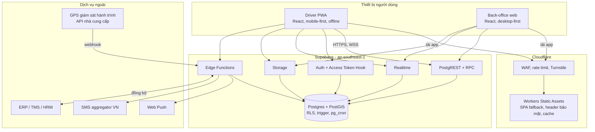
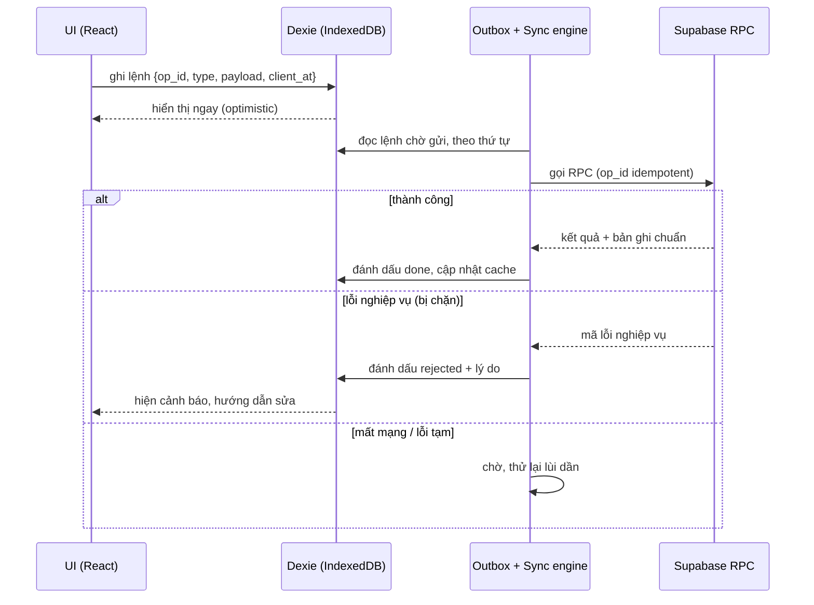
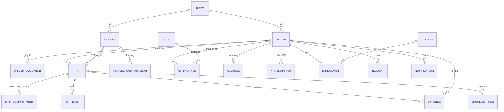
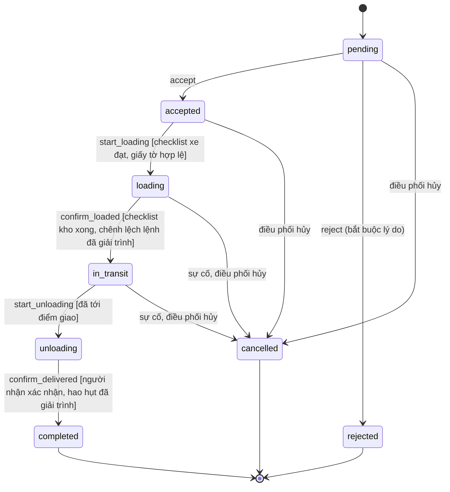
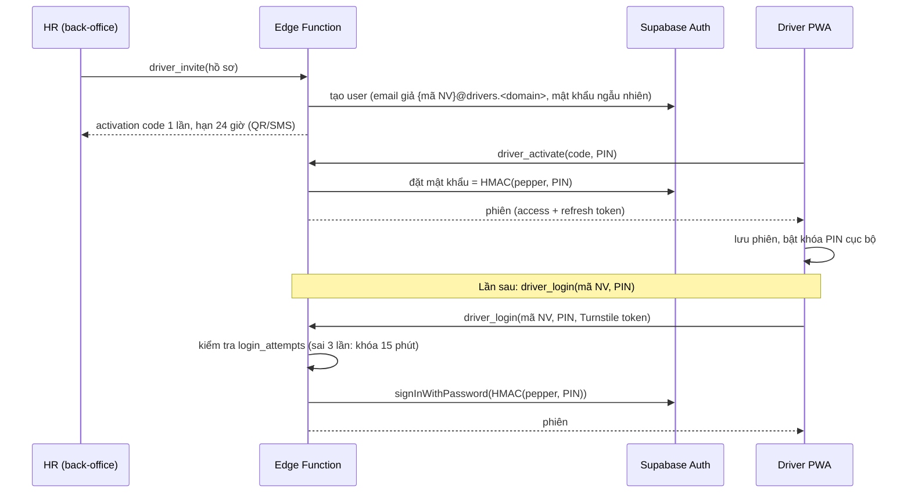

# DriverOS — Tài liệu thiết kế kỹ thuật (TDD)

> Phiên bản 0.1 · 2026-11-18 · Trạng thái: **bản nháp để review**
> Đầu vào: [specs.md](specs.md) (requirements v0.1) và [prompt-driveros.md](prompt-driveros.md) (đặc tả bản mock giao diện + quy tắc nghiệp vụ).
> Ràng buộc đã chốt: **Frontend React, mobile-first, deploy Cloudflare · Backend Supabase (BaaS)**.

---

## 0. Tóm tắt quyết định

| # | Quyết định | Lý do ngắn | Đánh đổi |
|---|---|---|---|
| D1 | **PWA** (Vite + React + TypeScript), không làm native ở P1; code giữ khả năng bọc **Capacitor** ở P2 | Một codebase, cập nhật tức thì, không qua store; đủ cho P1 | PWA **không theo dõi GPS nền** được (xem D6) |
| D2 | **Hai app tách bundle** trong một monorepo: `driver` (mobile-first) và `backoffice` (desktop-first) | Lái xe cần bundle nhỏ, offline; back-office cần bảng/biểu đồ nặng | Hai pipeline deploy |
| D3 | **Offline-first**: IndexedDB + hàng đợi lệnh (outbox) + khóa chính UUID do client sinh | Lái xe thường mất sóng ở kho/điểm giao | Phức tạp hơn CRUD thường; cần quy tắc xung đột rõ |
| D4 | **Logic nghiệp vụ nằm trong Postgres** (RPC + trigger + RLS), không để client tự đổi trạng thái | Chặn lái xe sửa dữ liệu bằng devtools; một nguồn sự thật cho hao hụt, KPI, điều kiện chặn | Logic viết bằng SQL/PLpgSQL, test bằng pgTAP |
| D5 | **Đăng nhập = mã nhân viên + PIN**, qua Edge Function có khóa sai 3 lần/15 phút; **không dùng SMS OTP của Supabase Auth** | Khớp FL-01; tiết kiệm SMS; chống brute-force PIN 6 số | Tự viết lớp proxy đăng nhập |
| D6 | **P1 chỉ lấy vị trí ở các mốc** (chấm công, mốc chuyến, SOS) bằng GPS trình duyệt; theo dõi liên tục dùng **GPS giám sát hành trình của xe** (P2) hoặc Capacitor | Trình duyệt không chạy nền ổn định khi tắt màn hình | Giờ lái (F-03.3) phụ thuộc quyết định này |
| D7 | Cloudflare chỉ **phục vụ frontend** (Workers Static Assets + header bảo mật); API đi thẳng tới Supabase | Ít thành phần, ít điểm lỗi | Không có BFF; nếu cần ẩn khóa bên thứ ba thì thêm Worker nhỏ |
| D8 | Supabase region **Singapore (ap-southeast-1)**, một project prod + một project staging | Gần Việt Nam nhất; tách dữ liệu thật khỏi thử nghiệm | Dữ liệu cá nhân ở nước ngoài → cần pháp chế rà soát (R5) |
| D9 | Ảnh nén phía client (≤ ~200 KB), lưu Supabase Storage; **không dùng ATEX ở P1** nhưng đưa vào quyết định phần cứng (mục 11) | Hàng nguy hiểm: điện thoại thường có thể bị cấm ở vùng nạp/xả | Chi phí tăng mạnh nếu bắt buộc ATEX |

**Hai điều cần chốt sớm nhất** (ảnh hưởng thiết kế, không chỉ chi phí):
1. Chính sách dùng điện thoại tại bệ nạp/xả (HSE) — quyết định luồng nhập liệu và phần cứng.
2. Có dùng GPS giám sát hành trình sẵn có của xe không — quyết định F-03.3, F-04.1, F-11.1.

---

## 1. Mục tiêu và ràng buộc kỹ thuật

### 1.1 Quy mô thiết kế

| Hạng mục | Giá trị | Ghi chú |
|---|---|---|
| Lái xe (người dùng chính) | 100 | Mục tiêu tính chi phí; thiết kế chịu được ~500 mà không đổi kiến trúc |
| Nhân viên back-office | ~10 | Điều phối, quản lý, kế toán, HR, HSE |
| Chuyến/ngày | ~200 | 2 chuyến/lái xe/ngày |
| Khoang/chuyến | ~5 | Xe bồn 5 khoang |
| Ảnh/lái xe/ngày | ~10 | Checklist, phiếu nạp/xả, hóa đơn |
| Tổ chức | 1 công ty, vài đội | Chưa multi-tenant (giả định A5) |

### 1.2 Yêu cầu phi chức năng

| Nhóm | Yêu cầu | Cách đáp ứng |
|---|---|---|
| Hiệu năng (di động) | Tải lần đầu ≤ 3 s trên 4G, máy tầm trung; mở lại ≤ 1 s | JS đầu ≤ ~200 KB gzip, tách route, precache app shell |
| Hiệu năng (API) | p95 RPC ≤ 500 ms từ Việt Nam | Region Singapore, truy vấn có index, RPC gộp thao tác |
| Offline | Ghi mốc, nạp/xả, chi phí, ảnh khi mất sóng và đồng bộ sau | Mục 4 |
| An toàn dữ liệu | Lái xe chỉ thấy dữ liệu của mình; không tự sửa trạng thái chuyến | RLS + RPC, không cấp quyền UPDATE trực tiếp |
| Sẵn sàng | Mục tiêu 99.5% giờ làm việc; app vẫn dùng được khi backend lỗi (offline) | Offline-first; nội dung khẩn cấp lưu cục bộ |
| Khả dụng ngoài đường | Một tay, ngoài nắng, ≤ vài chục giây/lần | Mục 3.5 |
| Truy vết | Mọi thay đổi nghiệp vụ có người, thời điểm, thiết bị | Bảng audit append-only |
| Khả năng thoát lock-in | Dữ liệu là Postgres chuẩn; frontend không phụ thuộc SDK ngoài `supabase-js` ở lớp data | Lớp repository (mục 3.3) |

### 1.3 Ràng buộc kỹ thuật từ lĩnh vực

- **Hàng nguy hiểm**: giấy tờ hết hạn, checklist không đạt hoặc chưa học khóa bắt buộc phải **chặn ở server**, không chỉ ẩn nút ở client.
- **Hao hụt** (nạp − xả) được tính ở server từ lượng từng khoang để làm chứng cứ; client chỉ hiển thị.
- **Tiền và định lượng**: lưu lít/tiền dạng số nguyên hoặc `numeric`, không dùng float.
- **Đồng hồ**: giờ nghiệp vụ lấy từ server. Giờ thiết bị chỉ được ghi kèm (`client_at`) và gắn cờ khi lệch.

---

## 2. Kiến trúc tổng thể



**Nguyên tắc luồng dữ liệu**

- Trình duyệt tải **mã** từ Cloudflare, nhưng **dữ liệu** đi thẳng tới Supabase (không qua Cloudflare Worker).
- **Đọc**: PostgREST (bảng/view có RLS). **Ghi nghiệp vụ**: luôn qua RPC `SECURITY DEFINER` kiểm tra điều kiện rồi mới ghi.
- **Edge Functions** chỉ dùng cho việc cần bí mật hoặc gọi ra ngoài: đăng nhập, gửi push/SMS, nhận webhook GPS, đồng bộ ERP, OCR (P3).
- **Realtime** chỉ cho thông báo và thay đổi trạng thái quan trọng; **không** phát vị trí liên tục (mục 9).

### 2.1 Vì sao PWA ở P1 và khi nào chuyển Capacitor

| Khả năng | PWA | Capacitor (bọc cùng code React) |
|---|---|---|
| Cài và cập nhật | Cài từ trình duyệt, cập nhật ngay khi deploy | Qua store hoặc phân phối nội bộ |
| Camera, GPS khi app mở | Có | Có |
| **GPS nền khi tắt màn hình** | **Không ổn định** | Có (plugin) |
| Push trên Android | Có (Web Push) | Có (FCM) |
| Push trên iOS | Chỉ khi đã "Thêm vào Màn hình chính", iOS 16.4 trở lên | Có |
| Background Sync khi mất mạng | Android Chrome có; **iOS không** → phải đồng bộ khi mở app | Có thể bổ sung |
| Chống giả GPS (mock location) | Không phát hiện được | Có thể phát hiện |

**Kết luận:** P1 dùng PWA vì P1 chỉ cần vị trí tại các mốc. **Điểm quyết định ở đầu P2**: nếu GPS xe không tích hợp được mà vẫn cần giờ lái/vi phạm tốc độ, bọc Capacitor (code React giữ nguyên, chỉ thêm lớp native cho vị trí nền). Điều kiện để việc này rẻ: mọi chỗ gọi vị trí/camera/push đều đi qua một module `platform/` (mục 3.2).

---

## 3. Thiết kế Frontend

### 3.1 Công nghệ

| Lớp | Lựa chọn | Ghi chú |
|---|---|---|
| Build | **Vite** + React + **TypeScript strict** | Khớp prompt mock |
| Routing | React Router; **`BrowserRouter` ở production** | Mock dùng `HashRouter` cho tiện; Cloudflare có SPA fallback nên đổi là việc nhỏ. Deep link từ push mở thẳng `/trips/:id` |
| Style | **CSS thuần với biến màu (custom properties)**, CSS Modules | Khớp prompt: không dùng UI framework nặng; giao diện kiểu iOS, có chế độ tối |
| Icon | `lucide-react` | Import theo từng icon để tree-shake |
| Server state | **TanStack Query** + persist vào IndexedDB | Cache và tải lại thông minh |
| Dữ liệu offline | **Dexie** (IndexedDB) | Bảng cục bộ + outbox |
| Form | React Hook Form + **Zod** | Schema Zod dùng chung với back-office (`packages/shared`) |
| PWA | `vite-plugin-pwa` (Workbox) | Precache app shell, `prompt` update |
| Backend SDK | `@supabase/supabase-js` + kiểu sinh từ schema (`supabase gen types`) | Chỉ dùng trong lớp data |
| Test | Vitest, Testing Library, Playwright | Mục 12 |
| Lỗi/giám sát | Sentry (gói miễn phí) | Mục 11 |

> Không ghim số phiên bản trong tài liệu; dùng bản ổn định mới nhất lúc khởi tạo và khóa bằng lockfile.

### 3.2 Cấu trúc monorepo

```
driveros/
├─ apps/
│  ├─ driver/                 # PWA lái xe (mobile-first)
│  │  ├─ src/
│  │  │  ├─ app/              # router, providers, shell + tab bar
│  │  │  ├─ features/         # today, jobs, attendance, finance, learning, profile, sos
│  │  │  ├─ platform/         # geo, camera, push, wakelock, haptics  ← điểm thay khi sang Capacitor
│  │  │  ├─ offline/          # dexie db, outbox, sync engine, photo queue
│  │  │  └─ ui/               # design system iOS-like: sheet, list, segmented, alert...
│  │  └─ public/{_headers,manifest.webmanifest,icons}
│  └─ backoffice/             # web điều phối/kế toán/HR/HSE
├─ packages/
│  ├─ shared/                 # kiểu, zod schema, quy tắc thuần (tính hao hụt, muộn/sớm, định mức)
│  ├─ data/                   # lớp repository: interface + adapter mock + adapter supabase
│  └─ config/                 # eslint, tsconfig, prettier
├─ supabase/
│  ├─ migrations/             # SQL có version
│  ├─ functions/              # Edge Functions (Deno)
│  ├─ tests/                  # pgTAP: RLS + RPC
│  └─ seed.sql
├─ wrangler.driver.jsonc
├─ wrangler.backoffice.jsonc
└─ .github/workflows/
```

### 3.3 Lớp data: đi từ mock sang Supabase mà không viết lại UI

Bản mock theo prompt giữ state trong Context + `localStorage`. Để dùng lại toàn bộ UI, tách một **interface repository** và có hai adapter.

```ts
// packages/data/src/trips.ts
export interface TripsRepo {
  listMine(range: 'today' | 'upcoming' | 'history'): Promise<Trip[]>;
  get(id: TripId): Promise<TripDetail>;
  accept(id: TripId): Promise<void>;
  reject(id: TripId, reasonCode: RejectReason, note?: string): Promise<void>;
  recordLoading(id: TripId, input: LoadingInput): Promise<void>;
  recordDelivery(id: TripId, input: DeliveryInput): Promise<DeliveryResult>; // có hao hụt tính ở server
}
```

| Adapter | Dùng khi | Ghi chú |
|---|---|---|
| `mock` | Giai đoạn 0 (prototype như prompt): dữ liệu mock + `localStorage`, đồng hồ giả lập | Cho phép demo và chốt UX trước khi có backend |
| `supabase` | P1 trở đi | Đọc từ cache Dexie, ghi qua outbox → RPC |

UI chỉ gọi hook (`useTrips()`, `useRecordDelivery()`) bọc repository. Quy tắc thuần (hao hụt, muộn/sớm, định mức) nằm ở `packages/shared` để **cùng một hàm** chạy ở client (hiển thị tức thì) và được **kiểm chứng lại ở server** (nguồn sự thật).

### 3.4 Điều hướng và màn hình (Driver PWA)

Tab bar dưới (khớp prompt): **Hôm nay · Công việc · Chấm công · Tài chính · Học tập**; hồ sơ/công việc khác mở bằng avatar ở góc phải; nút **SOS** luôn có ở trang Hôm nay.

| Tab | Route | Feature | Ghi chú kỹ thuật |
|---|---|---|---|
| Hôm nay | `/` | F-01.5, F-02.1, F-04.1 | Dữ liệu từ cache; thẻ chấm công dùng giờ server đã đồng bộ + độ lệch đồng hồ |
| Công việc | `/jobs`, `/jobs/:id` | F-02.1–F-02.9 | Chi tiết chuyến có nút hành động cố định phía dưới; hành động = một lệnh outbox |
| Chấm công | `/attendance` | F-04.1–F-04.3, F-04.6 | Lịch tháng; KPI đọc từ `kpi_snapshots` |
| Tài chính | `/finance` | F-05.1–F-05.6 | Sheet thêm chi phí; tính thành tiền nhiên liệu ở client, kiểm lại ở server |
| Học tập | `/learning` | F-06.* | Nội dung tải offline; quiz chấm ở server |
| Cá nhân | `/me` | F-01.*, F-07.*, F-09.* | Chế độ đang lái, giao diện sáng/tối |
| Sheet chung | (overlay) | F-03.1, F-03.4, F-07.2 | Checklist xe, SOS, báo sự cố, xin nghỉ |

### 3.5 Quy tắc UX di động (bắt buộc)

- Vùng chạm tối thiểu **48 × 48 px**; thao tác chính nằm nửa dưới màn hình (một tay).
- Tuân thủ safe-area (`env(safe-area-inset-*)`); tab bar và sheet không bị che.
- Số liệu nhập (lít, km, tiền) dùng `inputmode="decimal"`/`numeric`, bàn phím số, định dạng `vi-VN`.
- Tương phản cao, chữ lớn dùng được dưới nắng; chế độ tối đầy đủ.
- **Chế độ đang lái**: bật thủ công; ngoài ra nếu `coords.speed` > ~10 km/h (khi app đang mở) thì **khóa mọi form** và hiện cảnh báo dừng xe. Không có ngưỡng nào thay thế được quy trình của HSE.
- Mọi hành động có hậu quả (hoàn tất chuyến, từ chối chuyến, SOS) dùng hộp thoại xác nhận kiểu iOS.
- Trạng thái đồng bộ luôn nhìn thấy: biểu tượng "đã lưu trên máy / đang gửi / đã đồng bộ / lỗi cần xử lý".
- Mất mạng không phải lỗi: không dùng thông báo đỏ cho việc bình thường.

### 3.6 Hiệu năng

| Biện pháp | Chi tiết |
|---|---|
| Tách bundle | `driver` và `backoffice` riêng; mỗi tab là một chunk lazy |
| Ngân sách | JS khởi tạo ≤ ~200 KB gzip; theo dõi bằng `size-limit` trong CI |
| Font | Dùng font hệ thống (`-apple-system`, fallback Inter tự host nếu cần) — không tải font ngoài |
| Ảnh | Nén phía client; hiển thị thumbnail; ảnh gốc chỉ tải khi mở |
| Danh sách dài | Lịch sử chuyến/chi phí phân trang theo con trỏ `(created_at, id)` |
| Cache | Tài sản có hash: `immutable`; `index.html` và `sw.js`: `no-cache` (mục 10) |

---

## 4. Thiết kế Offline-first

### 4.1 Mô hình



### 4.2 Các thành phần

| Thành phần | Thiết kế |
|---|---|
| **Khóa chính** | UUID v7 do client sinh cho mọi bản ghi mới (chuyến-mốc, chi phí, checklist...). Server dùng `INSERT ... ON CONFLICT DO NOTHING` → gửi lại không tạo bản trùng |
| **Outbox** | Bảng Dexie `outbox(op_id, type, payload, client_at, device_id, status, attempts, last_error)`. Gửi **tuần tự theo thứ tự tạo** cho cùng một chuyến; khác chuyến có thể song song |
| **Idempotency** | Bảng server `client_ops(op_id pk, user_id, kind, result jsonb, applied_at)`. RPC kiểm tra `op_id` trước; trùng thì trả kết quả cũ |
| **Hàng đợi ảnh** | Tách riêng khỏi outbox; tải lên **resumable (TUS)**, gửi khi có mạng ổn định; metadata chuyến gửi **trước**, ảnh có thể đến **sau** (bản ghi có trạng thái `photo_pending`) |
| **Pull** | RPC `sync_pull(since cursor)` trả bản ghi thay đổi (`updated_at > cursor`) cho chuyến, xe, chính sách, khóa học của lái xe đó. Realtime chỉ để **báo có thay đổi** rồi pull |
| **Thời gian** | Mỗi lệnh mang `client_at`; server ghi `received_at`. Nếu `|received_at − client_at|` lớn hoặc giờ thiết bị lệch so với lần đồng bộ trước → `time_flag = true` để quản lý rà soát |
| **Phiên bản client** | Header `x-client-version`; server có `min_client_version`. Nếu app quá cũ, chặn **ghi** và yêu cầu cập nhật, nhưng vẫn cho **đọc** |
| **Mất dữ liệu cục bộ** | Xin `navigator.storage.persist()`; cảnh báo khi outbox còn lệnh chưa gửi mà người dùng đăng xuất hoặc xóa dữ liệu |

### 4.3 Quy tắc xung đột

| Đối tượng | Quy tắc | Lý do |
|---|---|---|
| Phân công/hủy/đổi chuyến (do điều phối) | **Server thắng** | Điều phối là nguồn lệnh |
| Mốc chuyến, nạp/xả, chấm công | **Append-only**; không ghi đè. Sai thì tạo bản điều chỉnh có lý do | Chứng cứ, tránh tranh chấp |
| Lệnh của lái xe khi chuyến đã bị hủy/đổi trên server | Bị **từ chối** với mã `TRIP_CHANGED`; UI hiện chuyến mới, lái xe xác nhận lại | FL-03 E7 |
| Chi phí đang nháp | **Client thắng** đến khi bấm gửi | Lái xe đang sửa |
| Chi phí đã gửi/duyệt | Chỉ server đổi; lái xe chỉ được thu hồi khi còn "Chờ duyệt" | F-05.6 |
| Hồ sơ cá nhân | Trường thường: client gửi, server nhận; trường nhạy cảm: tạo **yêu cầu thay đổi** chờ duyệt | F-01.2 |

### 4.4 Service Worker

- **Precache** app shell (HTML, JS, CSS, icon, font hệ thống không cần).
- **Runtime cache** cho nội dung khóa học đã tải (Cache Storage) và ảnh thumbnail.
- **API không cache** ở SW (dữ liệu đi qua Dexie/Query, tránh dữ liệu cũ khó kiểm soát).
- **Cập nhật**: kiểu `prompt` — hiện banner "Có phiên bản mới", **không tự tải lại** khi đang làm checklist hoặc nhập nạp/xả; cập nhật lúc rảnh hoặc khi người dùng bấm.
- Thẻ **xử lý khẩn cấp** (F-03.6) và danh bạ khẩn cấp được **precache bắt buộc**.

---

## 5. Thiết kế Backend (Supabase)

### 5.1 Thành phần và vai trò

| Thành phần | Dùng cho |
|---|---|
| **Postgres** (+ PostGIS, pg_cron, pg_net) | Dữ liệu, RLS, RPC, trigger, tác vụ định kỳ |
| **PostgREST** | Đọc dữ liệu có RLS; gọi RPC |
| **Auth** | Tài khoản và JWT; **Custom Access Token Hook** nhét `app_role`, `driver_id`, `fleet_id` vào token |
| **Realtime** | Thông báo/thay đổi trạng thái tới app và dashboard |
| **Storage** | Ảnh giấy tờ, bằng chứng chuyến, hóa đơn, nội dung học |
| **Edge Functions** (Deno) | Đăng nhập, gửi push/SMS, webhook GPS, ERP, OCR (P3) |

### 5.2 Mô hình dữ liệu



**Nhóm bảng theo Epic**

| Epic | Bảng chính | Cột đáng chú ý |
|---|---|---|
| EP-01 | `drivers`, `driver_documents`, `device_bindings`, `activation_codes`, `login_attempts` | `driver_documents(type, number, expires_at, status, file_path, required)` |
| EP-02 | `trips`, `trip_compartments`, `trip_events`, `partners` (kho/khách) | `trips.status`, `trip_compartments(ordered_l, loaded_l, delivered_l, temp_c, density, seal_load, seal_deliver)`; `trip_events(kind, at, lat, lng, accuracy_m, client_at, time_flag)` |
| EP-03 | `checklist_templates`, `checklist_items(required)`, `checklist_runs`, `checklist_results`, `incidents` | `incidents(kind, severity, status, lat, lng)` |
| EP-04 | `shift_templates`, `sites(geom, radius_m)`, `attendance`, `attendance_explanations`, `kpi_policies`, `kpi_snapshots`, `kpi_appeals`, `leave_requests` | `attendance(clock_in_at, clock_out_at, status_in, status_out, minutes_diff, source, needs_review)` |
| EP-05 | `expenses`, `fuel_logs`, `advances`, `expense_policies`, `pay_policies` | `expenses(category, amount, invoice_no, has_vat, photo_hash, status, reason)` |
| EP-06 | `courses`, `lessons`, `quizzes`, `quiz_questions`, `enrollments`, `lesson_progress`, `quiz_attempts`, `certificates` | `courses(required, deadline_rule)` |
| EP-07 | `vehicles`, `vehicle_compartments`, `vehicle_defects`, `vehicle_maintenance` | `vehicles(plate, inspection_exp, tank_cert_exp, km_next_service)` |
| EP-08/09 | `notifications`, `push_subscriptions`, `announcements`, `tasks`, `app_requests` | |
| EP-12 | `audit.log`, `client_ops`, `app_config`, `feature_flags`, `min_client_version` | `audit.log` append-only |
| EP-11 | `gps_points` (phân vùng theo tháng), `integration_outbox`, `integration_inbox` | |

**Quy ước chung:** khóa chính `uuid`; `created_at`, `updated_at`, `created_by`; xóa mềm bằng `deleted_at` cho dữ liệu chứng từ; lượng chất lỏng lưu **lít nguyên** (`integer`) hoặc `numeric(12,1)`; tiền lưu **đồng** (`bigint`).

### 5.3 Máy trạng thái chuyến

Khớp luồng trong prompt: *Chờ nhận → Đã nhận → Đang lấy hàng → Đang chạy → Đang xả hàng → Hoàn tất.*



Chuyển trạng thái **chỉ qua RPC `trip_transition`**; RLS **không** cấp UPDATE trực tiếp cho lái xe. Mỗi lần chuyển ghi một dòng `trip_events`.

### 5.4 Quy tắc nghiệp vụ là cấu hình, không hard-code

Giá trị lấy từ prompt được đặt làm **mặc định trong bảng cấu hình có version** (`app_config`, `kpi_policies`, `expense_policies`, `pay_policies`, `shift_templates`). Điều này giải quyết Open items #5, #6, #9 mà không phải sửa code khi công ty đổi chính sách.

| Quy tắc | Mặc định | Nơi lưu |
|---|---|---|
| Ca làm, dung sai | 06:00–15:00, ±5 phút | `shift_templates` |
| Đến sớm / đúng giờ / muộn | trước 05:55 / 05:55–06:05 / sau 06:05 | tính từ `shift_templates` |
| Về sớm | ra ca trước 14:55 | `shift_templates` |
| Hao hụt cho phép (nạp − xả) | 0,3% lượng nạp | `app_config` |
| Lệch lượng nạp so lệnh | 0,5% | `app_config` |
| Định mức ăn uống | 150.000 ₫/ngày | `expense_policies` |
| Không hóa đơn | chỉ nhận dưới 200.000 ₫ | `expense_policies` |
| Phụ cấp chuyến | 150.000 ₫ + 5.000 ₫/km, làm tròn chục nghìn | `pay_policies` |
| KPI trọng số | Chuyên cần 20, Giao đúng hẹn 20, Hao hụt 20, An toàn 15, Tiêu hao NL 15, Tuân thủ 10 | `kpi_policies` |
| Mức thưởng | ≥90: 2.000.000 · ≥80: 1.200.000 · ≥70: 600.000 | `kpi_policies` |
| Lương cơ bản / độc hại / BH | 8.500.000 / 500.000 / 10,5% | `pay_policies` |

Mỗi bản ghi tính toán (ví dụ `kpi_snapshots`) lưu **`policy_version`** đã dùng, để kết quả cũ không đổi khi chính sách đổi (FL-07 E2).

### 5.5 RPC — các lệnh nghiệp vụ

| RPC | Việc làm | Kiểm tra chính |
|---|---|---|
| `clock_in(op_id, lat, lng, accuracy_m, client_at)` | Ghi công vào | Trong geofence `ST_DWithin`, độ chính xác hợp lệ, tính sớm/đúng/muộn theo ca; ngoài vùng hoặc offline → `needs_review` |
| `clock_out(...)` | Ghi công ra | Ra trước giờ → tính về sớm |
| `trip_accept / trip_reject` | Nhận/từ chối | Lý do bắt buộc khi từ chối |
| `trip_start_loading` | Chuyển sang lấy hàng | Có `checklist_run` hôm nay đạt hết mục bắt buộc; giấy tờ bắt buộc còn hạn; khóa bắt buộc đạt |
| `trip_record_loading` | Ghi lượng nạp từng khoang, chì, nhiệt độ | Lệch lệnh > ngưỡng → bắt buộc `explanation` |
| `trip_start_unloading` | Tới điểm giao | Vị trí gần điểm giao (cảnh báo, không chặn cứng) |
| `trip_record_delivery` | Ghi lượng xả, tính hao hụt, xác nhận người nhận | Có xác nhận (OTP/chữ ký/ảnh); hao hụt > ngưỡng → bắt buộc giải trình; chì khớp lúc nạp |
| `expense_submit` | Gửi chi phí | Định mức, không hóa đơn < ngưỡng, **trùng hóa đơn** (số hóa đơn hoặc `photo_hash`) |
| `quiz_submit` | Chấm bài ở server | Đáp án không lộ cho client |
| `incident_report / sos_trigger` | Tạo sự cố, bắn thông báo leo thang | Hủy được trong 10 s trước khi phát |
| `compute_kpi(driver_id, period)` | Tạo `kpi_snapshot` | Dùng dữ liệu thật: công, chuyến, hao hụt, checklist; "An toàn" và "Tiêu hao NL" có thể nhập/mock ở P1–P2 |

Ví dụ rút gọn (minh họa, chưa phải mã cuối):

```sql
create or replace function public.trip_record_delivery(
  p_op_id uuid, p_trip_id uuid, p_items jsonb, p_receiver jsonb,
  p_explanation text default null, p_client_at timestamptz default now()
) returns jsonb
language plpgsql security definer set search_path = public as $$
declare
  v_driver uuid := (auth.jwt() ->> 'driver_id')::uuid;
  v_loaded int; v_delivered int; v_loss int; v_pct numeric; v_limit numeric;
  v_prev jsonb;
begin
  -- idempotency
  select result into v_prev from client_ops where op_id = p_op_id;
  if found then return v_prev; end if;

  perform 1 from trips where id = p_trip_id and driver_id = v_driver and status = 'unloading';
  if not found then raise exception 'TRIP_STATE_INVALID' using errcode = 'P0001'; end if;

  -- ghi lượng xả từng khoang
  update trip_compartments tc
     set delivered_l = (i->>'delivered_l')::int, seal_deliver = i->>'seal_deliver'
    from jsonb_array_elements(p_items) i
   where tc.trip_id = p_trip_id and tc.id = (i->>'compartment_id')::uuid;

  select sum(loaded_l), sum(delivered_l) into v_loaded, v_delivered
    from trip_compartments where trip_id = p_trip_id;
  v_loss := v_loaded - v_delivered;
  v_pct  := round(100.0 * v_loss / nullif(v_loaded,0), 3);
  v_limit := (select (value)::numeric from app_config where key = 'loss_limit_pct');

  if v_pct > v_limit and coalesce(trim(p_explanation),'') = '' then
    raise exception 'LOSS_EXPLANATION_REQUIRED' using errcode = 'P0001';
  end if;
  if p_receiver ->> 'method' is null then
    raise exception 'RECEIVER_CONFIRMATION_REQUIRED' using errcode = 'P0001';
  end if;

  update trips set status = 'completed', completed_at = now(),
         loss_l = v_loss, loss_pct = v_pct, loss_explanation = p_explanation
   where id = p_trip_id;
  insert into trip_events(trip_id, kind, at, client_at, actor) values
    (p_trip_id, 'delivered', now(), p_client_at, v_driver);

  insert into client_ops(op_id, user_id, kind, result)
  values (p_op_id, auth.uid(), 'trip_record_delivery',
          jsonb_build_object('loss_l', v_loss, 'loss_pct', v_pct));
  return jsonb_build_object('loss_l', v_loss, 'loss_pct', v_pct);
end $$;
```

### 5.6 Bảo mật dữ liệu: RLS

**Vai trò** (`app_role` trong JWT): `driver`, `assistant`, `dispatcher`, `fleet_manager`, `accountant`, `hr`, `hse`, `admin`.

```sql
-- Custom Access Token Hook: nhét claim vào JWT
create or replace function public.custom_access_token_hook(event jsonb)
returns jsonb language plpgsql stable as $$
declare claims jsonb := event->'claims'; u record;
begin
  select app_role, driver_id, fleet_id into u from public.user_profiles
   where user_id = (event->>'user_id')::uuid;
  claims := jsonb_set(claims, '{app_role}',  to_jsonb(u.app_role));
  claims := jsonb_set(claims, '{driver_id}', coalesce(to_jsonb(u.driver_id), 'null'));
  claims := jsonb_set(claims, '{fleet_id}',  coalesce(to_jsonb(u.fleet_id),  'null'));
  return jsonb_set(event, '{claims}', claims);
end $$;

-- Lái xe chỉ đọc chuyến của mình; nhân sự điều hành đọc theo đội
alter table trips enable row level security;

create policy trips_driver_read on trips for select to authenticated
  using ( driver_id = ((select auth.jwt()) ->> 'driver_id')::uuid );

create policy trips_staff_read on trips for select to authenticated
  using ( ((select auth.jwt()) ->> 'app_role') in ('dispatcher','fleet_manager','hse','admin')
          and fleet_id = ((select auth.jwt()) ->> 'fleet_id')::uuid );

-- KHÔNG có policy INSERT/UPDATE/DELETE cho lái xe: ghi chỉ qua RPC security definer
```

Nguyên tắc:

- Bọc `auth.jwt()` trong `(select ...)` để Postgres cache kết quả, tránh quét chậm khi bảng lớn.
- Mọi bảng trong schema `public` **bật RLS**; bảng nội bộ (`client_ops`, `audit`) đặt schema riêng, không phơi ra API.
- **Khóa `service_role` không bao giờ nằm ở client**; chỉ dùng trong Edge Functions.
- Có bộ test **pgTAP** cho mỗi vai trò: "lái xe A không đọc được chuyến của lái xe B", "lái xe không UPDATE được `trips`".

### 5.7 Xác thực và phiên

**Lái xe**



- Mật khẩu thật trong Auth là **HMAC(pepper, PIN)**, nên gọi thẳng API Auth bằng PIN 6 số **không đăng nhập được**; chỉ đi qua Edge Function mới có khóa sai nhiều lần. (Chống brute-force PIN 6 số.)
- Phiên dài (ví dụ 30 ngày) với refresh token xoay vòng; thu hồi bằng cách xóa phiên + `device_bindings.revoked_at` khi mất máy hoặc hết hợp đồng (FL-01 E6).
- Một tài khoản gắn **một thiết bị chính**; đăng nhập thiết bị mới cần HR cấp lại activation code.
- Ở thiết bị, khóa PIN/sinh trắc cục bộ (WebAuthn nền tảng nếu có) chỉ để **chặn người cầm máy**, không thay cho xác thực server.

**Nhân viên back-office**: email + mật khẩu + **MFA TOTP** (Auth có sẵn); SSO là tùy chọn sau.

### 5.8 Storage

| Bucket | Nội dung | Truy cập |
|---|---|---|
| `driver-docs` | GPLX, chứng chỉ, giấy khám sức khỏe | Riêng tư. Lái xe: ghi cho mình, đọc của mình. HR/HSE: đọc theo đội |
| `trip-evidence` | Phiếu xuất/nhận, ảnh niêm phong, chữ ký, ảnh sự cố | Riêng tư, theo chuyến |
| `receipts` | Hóa đơn chi phí | Riêng tư, theo lái xe + kế toán |
| `course-content` | Video, PDF bài học | Đọc bằng signed URL, cho phép tải offline |

- Đường dẫn: `{bucket}/{yyyy}/{mm}/{driver_id}/{uuid}.webp` — dễ áp dụng chính sách lưu trữ và dọn dẹp.
- Truy cập bằng **signed URL** hạn ngắn; không dùng URL công khai cho ảnh giấy tờ.
- Client nén ảnh trước (≤ 1280 px, WebP/JPEG chất lượng ~0,7), bỏ EXIF vị trí, tính **SHA-256** để phát hiện ảnh dùng lại (F-12.5).

### 5.9 Edge Functions

| Function | Trigger | Việc làm |
|---|---|---|
| `driver-invite / driver-activate / driver-login` | HTTP | Mục 5.7 |
| `push-send` | DB webhook (`notifications` insert) | Gửi Web Push tới `push_subscriptions`; thất bại thì để Realtime/in-app |
| `sms-send` | Gọi từ RPC/function | Gửi SMS qua aggregator nội địa: OTP người nhận hàng, cảnh báo SOS |
| `receiver-otp` | HTTP | Sinh/kiểm mã OTP người nhận, hạn ngắn, giới hạn số lần |
| `gps-webhook` (P2) | HTTP (webhook nhà cung cấp) | Xác thực chữ ký, ghi `gps_points`, kích hoạt cảnh báo tốc độ/giờ lái |
| `erp-sync` (P2–P3) | Cron + webhook | Hai chiều qua `integration_outbox/inbox`, có retry và dead-letter |
| `ocr-invoice` (P3) | HTTP | Gọi dịch vụ OCR, trả trường gợi ý (lái xe vẫn xác nhận) |

Quy tắc: hàm **idempotent**, log có `request_id`, giới hạn thời gian chạy, bí mật lưu bằng Supabase secrets.

### 5.10 Tác vụ định kỳ (`pg_cron`)

| Lịch | Việc | Feature |
|---|---|---|
| Hằng ngày | Nhắc giấy tờ/chứng chỉ sắp hết hạn (30/60 ngày), đánh dấu hết hạn → chặn nhận chuyến | F-01.4 |
| Hằng ngày | Nhắc khóa bắt buộc sắp tới hạn; quá hạn → cờ chặn theo loại hàng | F-06.2, F-06.8 |
| Mỗi 5 phút | Chuyến chờ nhận quá hạn phản hồi → trả điều phối + gắn cờ | F-02.3 |
| Cuối ca | Đóng ca quên chấm công ra, gắn cờ giải trình | FL-02 E6 |
| Cuối tháng | `compute_kpi` toàn bộ lái xe, tạo snapshot nháp | F-04.6 |
| Hằng ngày | Tạo/cắt phân vùng `gps_points`, xóa dữ liệu quá hạn lưu | EP-11 |

### 5.11 Realtime và thông báo

| Kênh | Người nghe | Nội dung |
|---|---|---|
| `driver:{driver_id}` | Lái xe | Chuyến mới/đổi/hủy, kết quả duyệt, nhắc |
| `fleet:{fleet_id}` | Điều phối, quản lý | Trạng thái chuyến, sự cố, SOS, giải trình chờ duyệt |

- Với ~100 lái xe, đủ dùng thay đổi bảng (`postgres_changes`) lọc theo `driver_id`; khi tăng quy mô nên chuyển sang **Broadcast phát từ trigger** để giảm tải.
- Thông báo ghi vào bảng `notifications` (nguồn sự thật) → vừa hiện in-app (Realtime) vừa bắn Web Push (`push-send`). Mất push không mất thông báo.
- **Vị trí xe trên dashboard**: P1 chỉ có vị trí ở các mốc; P2 lấy từ GPS xe và **làm mới theo chu kỳ 15–30 s** (poll hoặc Broadcast có giới hạn), không bắn mỗi điểm GPS qua Realtime (xem mục 9 vì sao).

---

## 6. Back-office (web)

| Hạng mục | Thiết kế |
|---|---|
| Đối tượng | Điều phối, quản lý đội, kế toán, HR, HSE |
| Bố cục | Desktop-first; sidebar theo vai trò; bảng có lọc, sắp xếp, phân trang cơ sở con trỏ |
| Màn hình P1 | Lệnh chuyến + phân công (F-10.1) kèm **kiểm tra điều kiện tự động** (giấy tờ, bồn–hàng, khóa học); hồ sơ & giấy tờ lái xe (F-10.3); cấu hình ca/KPI/geofence (F-10.4); duyệt chi phí & quyết toán (F-10.5) |
| Màn hình P2 | Dashboard điều hành, quản trị đào tạo, quản lý sự cố |
| Dữ liệu | Cùng RPC/RLS với app lái xe; vai trò khác nhau thấy phạm vi khác nhau |
| Xuất dữ liệu | CSV/Excel qua RPC/view cho kế toán và payroll (trước khi có tích hợp F-11.3/F-11.4) |
| Bảo mật | MFA bắt buộc, phiên ngắn hơn lái xe, ghi audit mọi thao tác duyệt/sửa |

Điều kiện phân công (F-10.1) cài đặt thành **một hàm `assign_eligibility(driver, vehicle, trip)`** dùng chung: back-office gọi để cảnh báo trước khi giao, `trip_start_loading` gọi lại để **chặn** ở thời điểm thực hiện (giấy tờ có thể hết hạn giữa lúc giao và lúc chạy).

---

## 7. Tích hợp

| Tích hợp | Phase | Cách làm | Rủi ro |
|---|---|---|---|
| GPS giám sát hành trình xe | P2 | Webhook hoặc poll API nhà cung cấp → `gps_points`; ghép xe ↔ chuyến theo biển số | Chưa biết có API không (Open #4). Nếu không: Capacitor hoặc chỉ dùng vị trí ở mốc |
| Kho / TMS / ERP | P2 | `integration_inbox` nhận lệnh xuất; `integration_outbox` trả phiếu giao đã xác nhận; retry + dead-letter | Chuẩn dữ liệu của hệ thống kho (Open #7) |
| Kế toán | P3 | Xuất quyết toán/tạm ứng qua file hoặc API | Chuẩn chứng từ |
| HRM / Payroll | P3 | Nhận hồ sơ; trả công + KPI | Định danh lái xe thống nhất |
| Bản đồ | P1–P2 | P1 chỉ **mở link Google Maps** (miễn phí, đúng prompt). P2 thêm geocoding/ETA nếu cần | Chi phí API nếu dùng nhiều |
| SMS | P1 | Aggregator nội địa qua Edge Function | Cần đăng ký brandname |

Mọi tích hợp đi qua **bảng outbox/inbox** để thao tác lỗi không làm hỏng giao dịch chính và có thể phát lại.

---

## 8. Bảo mật và tuân thủ

| Rủi ro | Biện pháp |
|---|---|
| Lái xe sửa dữ liệu bằng devtools | Không cấp quyền ghi trực tiếp; mọi thay đổi qua RPC kiểm tra ở server; RLS kiểm thử pgTAP |
| Brute-force PIN | HMAC + Edge Function + khóa 15 phút + Turnstile + rate limit Cloudflare |
| Mất/đánh cắp điện thoại | Thu hồi phiên và `device_bindings` từ back-office; khóa PIN cục bộ; không lưu ảnh giấy tờ lâu trên máy |
| Giả GPS / giả giờ | Giờ lấy từ server; `accuracy_m` kèm theo; ngoài vùng → `needs_review`; đối chiếu GPS xe (P2). **PWA không phát hiện được mock location** — chấp nhận ở P1 |
| Ảnh/hóa đơn dùng lại | SHA-256 + số hóa đơn → từ chối trùng; ảnh bị gắn cờ khi hash đã tồn tại |
| Lộ khóa | `service_role` chỉ ở Edge Functions; khóa `anon` công khai là bình thường vì có RLS; secrets không đưa vào repo |
| XSS | CSP chặt (mục 10), không `dangerouslySetInnerHTML`, nội dung người dùng được escape |
| Lộ dữ liệu cá nhân | Bucket riêng tư + signed URL; mã hóa khi lưu trữ (mặc định của nền tảng); audit truy cập tài liệu nhạy cảm |
| Mất dữ liệu | Sao lưu hằng ngày (có sẵn ở gói Pro); khuyến nghị **PITR** cho dữ liệu chứng từ (mục 11); diễn tập khôi phục mỗi quý |
| Truy vết | `audit.log` append-only qua trigger: ai, khi nào, giá trị cũ/mới, thiết bị |

**Quyền riêng tư và pháp lý** (cần pháp chế xác nhận, không tự kết luận):

- Chỉ thu vị trí **trong ca/chuyến**; có thông báo và sự đồng ý của lái xe ở bước kích hoạt (FL-01 D4; Open #13).
- Dữ liệu cá nhân (GPLX, vị trí) đặt ở region Singapore → cần rà soát quy định bảo vệ dữ liệu cá nhân hiện hành của Việt Nam và có cần đánh giá/đăng ký gì không.
- Thời hạn lưu trữ: đề xuất ảnh chứng từ chuyến và công/KPI **≥ 5 năm** (kế toán), GPS thô **90 ngày** rồi rút gọn. Cần chốt với pháp chế/kế toán.
- Hàng nguy hiểm: ngưỡng giờ lái, giấy phép, tuyến cấm lấy theo quy định hiện hành sau khi HSE/pháp chế xác nhận (EN-02).

**Điện thoại ở khu vực nguy hiểm cháy nổ:** nhiều kho xăng dầu cấm thiết bị điện tử thường ở bệ nạp/xả. Thiết kế phải cho phép **nhập liệu ngoài vùng nguy hiểm** (ví dụ ghi số liệu từ phiếu xuất/nhận sau khi rời bệ, chụp phiếu ở vùng an toàn) và lưu `captured_at` thật của từng ảnh. Nếu HSE yêu cầu thiết bị đạt chuẩn chống cháy nổ (ATEX), xem phương án C ở mục 11.

---

## 9. Dung lượng và hiệu năng

### 9.1 Ước lượng dữ liệu (100 lái xe)

| Dữ liệu | Công thức | Khối lượng |
|---|---|---|
| Chuyến | 100 × 2 × 26 ngày | ~5.200/tháng |
| Mốc chuyến | ~10/chuyến | ~52.000 dòng/tháng |
| Chi phí | 100 × ~4 × 26 | ~10.400 dòng/tháng |
| Audit | ~100.000 dòng/tháng | ~50 MB/tháng |
| Dữ liệu quan hệ (không gồm GPS) | | **< 1 GB/năm** |
| Ảnh | 100 × 10 ảnh × ~300 KB × 26 ngày | ~7,8 GB/tháng ≈ **~94 GB/năm** |
| Ảnh sau khi nén ~200 KB | | ~5,2 GB/tháng ≈ **~62 GB/năm** |
| GPS điểm (P2, mỗi 60 s khi chạy) | 100 × ~480 điểm × 26 | ~1,25 triệu dòng/tháng ≈ ~200 MB/tháng |

**Hệ quả thiết kế**

- **Ảnh là thứ chiếm dung lượng**, không phải DB. Nén phía client là bắt buộc; đặt chính sách lưu trữ và (nếu cần) chuyển ảnh cũ sang kho rẻ hơn (R2) sau 12 tháng.
- **GPS** phải phân vùng theo tháng, giữ thô 90 ngày, sau đó rút gọn (mỗi 5 phút) hoặc xóa.
- **Không bắn từng điểm GPS qua Realtime**: 100 xe × 60 điểm/giờ × nhiều người xem sẽ sớm chạm giới hạn thông điệp của nền tảng. Dashboard làm mới theo chu kỳ.

### 9.2 Tải

- Đỉnh tải là **đầu ca** (~100 lượt chấm công trong ~10 phút) và **cuối ca** — vài chục request/giây ở mức tối đa, nằm trong sức chịu của một instance Small.
- Realtime: ~110 kết nối đồng thời (100 lái xe + ~10 staff).
- Theo dõi: kích thước DB, số kết nối, độ trễ RPC; cảnh báo khi ≥ 70% giới hạn.
- Mốc nâng cấp: khi > ~500 lái xe hoặc CPU instance liên tục > 60% thì nâng compute; chưa cần đổi kiến trúc.

---

## 10. Triển khai (Cloudflare) và môi trường

### 10.1 Cloudflare: Workers Static Assets

Cloudflare đang hướng người dùng tới **Workers với static assets** cho ứng dụng SPA. Mỗi app một Worker (assets-only, không cần mã Worker):

```jsonc
// wrangler.driver.jsonc
{
  "$schema": "node_modules/wrangler/config-schema.json",
  "name": "driveros-driver",
  "compatibility_date": "2026-11-01",
  "assets": {
    "directory": "./apps/driver/dist",
    "not_found_handling": "single-page-application"
  },
  "routes": [{ "pattern": "app.example.com", "custom_domain": true }]
}
```

| Hạng mục | Cấu hình |
|---|---|
| Tên miền | `app.<domain>` (lái xe), `admin.<domain>` (back-office); tùy chọn `api.<domain>` trỏ Supabase (custom domain add-on) |
| Cache | `/assets/*` (có hash) `immutable, max-age=1 năm`; `index.html`, `sw.js`, `manifest` → `no-cache` |
| Bảo vệ | WAF managed rules; **rate limiting** cho endpoint đăng nhập (Edge Function); **Turnstile** ở màn đăng nhập |
| Phân tích | Cloudflare Web Analytics (không cookie) |
| Xem trước | Mỗi PR có URL xem trước (version preview của Workers) |
| Rollback | Quay về version Worker trước bằng `wrangler rollback` hoặc bảng điều khiển |

`apps/driver/public/_headers` (CSP và cache):

```
/*
  Content-Security-Policy: default-src 'self'; script-src 'self'; style-src 'self' 'unsafe-inline'; img-src 'self' data: blob: https://<ref>.supabase.co; connect-src 'self' https://<ref>.supabase.co wss://<ref>.supabase.co https://*.ingest.sentry.io; frame-ancestors 'none'; base-uri 'self'
  X-Content-Type-Options: nosniff
  Referrer-Policy: strict-origin-when-cross-origin
  Permissions-Policy: geolocation=(self), camera=(self), microphone=()
/assets/*
  Cache-Control: public, max-age=31536000, immutable
/index.html
  Cache-Control: no-cache
/sw.js
  Cache-Control: no-cache
```

### 10.2 Môi trường

| Môi trường | Frontend | Backend | Dùng cho |
|---|---|---|---|
| **local** | `vite dev` | `supabase start` (Docker) | Phát triển, test RLS |
| **staging** | Worker `*-staging` + preview theo PR | Project Supabase thứ hai (dữ liệu giả) | UAT, pilot thử |
| **prod** | Worker prod | Project Supabase prod | Dữ liệu thật |

Quy ước: **migration chỉ tiến** (không sửa migration đã áp dụng); đổi schema theo kiểu *expand → migrate → contract* để app cũ (đang offline) không vỡ; client cũ vẫn gửi được lệnh nhờ `min_client_version` và RPC có phiên bản (`v1_`, `v2_`) khi đổi hợp đồng.

### 10.3 CI/CD (GitHub Actions)

| Giai đoạn | Việc làm |
|---|---|
| Mỗi PR | Lint, typecheck, unit test, build, `size-limit`, **pgTAP** (RLS + RPC trên Supabase local), Playwright e2e (viewport di động, chế độ offline) |
| Merge vào nhánh chính | Áp migration lên **staging**, deploy Worker staging |
| Gắn tag phát hành | Áp migration lên **prod** (cần phê duyệt thủ công), deploy Worker prod |
| Bảo mật | Quét phụ thuộc, quét secret; secrets lưu ở GitHub/Cloudflare/Supabase, không ở repo |

**Phát hành an toàn:** đổi hành vi lớn đi sau **feature flag** (bảng `feature_flags`, đọc theo vai trò/đội) để bật cho 1 đội pilot trước; lái xe không bị ép tải lại giữa chuyến (mục 4.4).

---

## 11. Giám sát và vận hành

| Lớp | Công cụ | Theo dõi |
|---|---|---|
| Lỗi frontend | Sentry (gói miễn phí đủ cho 100 người) | Lỗi JS, hiệu năng, phiên bản |
| Đồng bộ | Bảng `client_telemetry` (số lệnh kẹt, tuổi lệnh cũ nhất, lỗi theo mã) | Lái xe có lệnh kẹt > 30 phút → cảnh báo điều phối |
| Backend | Log của Supabase (API, Auth, Edge, Postgres), báo cáo sử dụng | Lỗi 5xx, độ trễ RPC, kết nối, dung lượng |
| Uptime | Dịch vụ kiểm tra bên ngoài (ví dụ UptimeRobot) cho app, API, hàm đăng nhập | Báo kênh chat |
| Nghiệp vụ | View/dashboard: chuyến kẹt trạng thái, hao hụt bất thường, giấy tờ hết hạn | Điều phối/HSE |

**Vận hành**

- Sổ tay xử lý: lái xe không đăng nhập được, thu hồi thiết bị, outbox kẹt, khôi phục dữ liệu.
- Diễn tập khôi phục sao lưu mỗi quý; ghi lại thời gian khôi phục thực tế.
- Phân quyền truy cập bảng điều khiển Supabase/Cloudflare theo nguyên tắc tối thiểu, bật MFA cho quản trị.

---

## 12. Chiến lược kiểm thử

| Cấp | Nội dung | Công cụ |
|---|---|---|
| Đơn vị | Quy tắc thuần: hao hụt, muộn/sớm, định mức, phụ cấp, KPI | Vitest (dùng chung `packages/shared`) |
| CSDL | RLS theo từng vai trò; RPC: chặn đúng điều kiện (checklist, giấy tờ, hao hụt, trùng hóa đơn); trạng thái chuyến không nhảy bước | **pgTAP** |
| Tích hợp | Edge Functions: đăng nhập (khóa sai), OTP người nhận, webhook GPS | Deno test + Supabase local |
| E2E | Luồng FL-01…FL-07 trên viewport di động; **offline**: ngắt mạng giữa chừng rồi đồng bộ; trùng lệnh gửi lại; chuyến bị hủy khi đang offline | Playwright (chế độ offline, giả lập mạng chậm) |
| Hiệu năng | k6: 100–300 người dùng ảo, đỉnh đầu ca; Lighthouse CI cho ngân sách bundle | k6, Lighthouse |
| Thiết bị thật | Ít nhất 3 máy Android tầm trung/cũ + 1 iPhone; thử ngoài nắng, mạng yếu | Thủ công |
| Thực địa | Pilot 1 đội tại kho thật, có HSE tham gia, thử trọn một chuyến | Thủ công |

**Điều kiện xong cho một luồng:** có e2e chạy xanh ở chế độ **online và offline**, có test pgTAP cho mọi điều kiện chặn, và đã thử trên máy thật.

---

## 13. Chi phí

> **Mọi số liệu dưới đây là ước tính để lập ngân sách, không phải báo giá.** Đơn giá đám mây và điện thoại lấy từ nguồn công khai (cuối mục); các dòng ghi "chưa kiểm chứng" là giả định cần xác nhận bằng báo giá hoặc trang giá chính thức trước khi duyệt ngân sách.
> Tỷ giá giả định: **1 USD ≈ 26.000 ₫**. Quy mô: **100 lái xe**.

### 13.1 Phần cứng (một lần)

Có ba phương án; khác nhau chủ yếu ở điện thoại.

| Hạng mục | Đơn giá | A: Tự mang máy (BYOD) | **B: Công ty cấp máy tầm trung (khuyến nghị)** | C: Máy chống cháy nổ (ATEX) |
|---|---|---|---|---|
| Điện thoại | B: ~4,49 triệu (Galaxy A16 5G 8/128 GB, giá niêm yết một đại lý). C: ~35 triệu *(giả định, chưa kiểm chứng)* | — | 110 máy × 4,49 tr = **493,9 tr** (100 + 10% dự phòng) | 110 × 35 tr = **3.850 tr** |
| Ốp chống sốc + dán màn hình | ~0,2 tr/máy | — (lái xe tự lo) | 110 × 0,2 = **22 tr** | đã gồm trong máy |
| Giá đỡ chống rung + sạc xe | ~0,4 tr/bộ *(giả định; xe tải thường 24 V nên cần sạc 24 V→5 V)* | 100 × 0,4 = **40 tr** | 100 × 0,4 = **40 tr** | 100 × 0,4 = **40 tr** |
| Nhãn QR chịu thời tiết (xe + bồn) | ~25 nghìn/nhãn, ~200 nhãn *(giả định)* | **5 tr** | **5 tr** | **5 tr** |
| **Tổng một lần** | | **≈ 45 tr** (~$1.700) | **≈ 561 tr** (~$21.600) | **≈ 3.895 tr** (~$149.800) |

**Không tính trong bảng:**

- **PC/laptop back-office**: giả định đã có sẵn (~10 người dùng web).
- **Thiết bị GPS giám sát hành trình**: xe tải kinh doanh vận tải thường đã bắt buộc có thiết bị theo quy định hiện hành (đang có dự thảo mở rộng yêu cầu), nên coi là có sẵn. Tôi **không tìm được báo giá công khai**; nếu phải mua mới cho 100 xe, cần hỏi trực tiếp nhà cung cấp (BA GPS, Viettel V-Tracking, Adsun, Eposi…) cả giá thiết bị lẫn phí dịch vụ hằng tháng và **có API hay không** (Open #4).
- **Máy ATEX (phương án C)** chỉ cần nếu HSE yêu cầu dùng điện thoại **trong vùng nguy hiểm**. Nếu quy trình cho phép nhập liệu ngoài vùng đó thì dùng **B**. Con số 35 triệu/máy là giả định thô để cho thấy bậc độ lớn chênh lệch (~7 lần), cần báo giá thật.

### 13.2 Chi phí vận hành hằng tháng

**Dịch vụ đám mây**

| Hạng mục | Lean (pilot 1 đội) | **Khuyến nghị (production)** | Ghi chú / độ tin cậy |
|---|---|---|---|
| Supabase Pro (gói cơ sở) | $25 | $25 | Từ nguồn công khai: Pro $25/tháng, gồm 100.000 MAU, 8 GB DB, 100 GB file, 250 GB egress, tín dụng compute $10 |
| Compute Small (thực trả sau tín dụng $10) | $5 | $5 | Small ≈ $15 − $10 tín dụng. Micro đủ cho pilot; Small cho production |
| Project Supabase staging (Micro) | — | $10 | Ước tính; tùy chọn khác là chạy staging bằng Supabase local |
| Sao lưu PITR (khôi phục theo thời điểm) | — | ~$100 | **Chưa kiểm chứng.** Khuyến nghị cho dữ liệu chứng từ nguy hiểm; có thể bỏ ở pilot |
| Custom domain add-on cho API | — | ~$10 | **Chưa kiểm chứng.** Tùy chọn |
| Cloudflare Workers (frontend) | $0 | $5 | Tài sản tĩnh không tính vào hạn mức request; gói miễn phí đủ cho pilot. Gói trả phí tối thiểu $5/tháng |
| Tên miền | ~$1 | ~$1 | ~$12/năm |
| SMS (OTP người nhận + cảnh báo SOS) | — | ~$69 | ~1.800 SMS × ~1.000 ₫ *(giả định đơn giá aggregator nội địa)*. Giả định 30% lượt giao dùng OTP; mặc định chữ ký/ảnh phiếu thì gần như bằng 0 |
| Geocoding/bản đồ (nếu dùng API) | — | ~$10 | Ước tính; P1 chỉ mở link Google Maps nên có thể $0 |
| Sentry, Cloudflare Turnstile/WAF cơ bản | $0 | $0 | Gói miễn phí |
| **Tổng đám mây / tháng** | **~$31 (~0,8 tr ₫)** | **~$235 (~6,1 tr ₫)** | |

Lưu ý khi dung lượng tăng: ảnh ~5–8 GB/tháng sẽ **vượt 100 GB file đã gồm sau khoảng 12–18 tháng**; phần vượt tính theo GB/tháng (đơn giá khoảng vài chục cent đến vài cent mỗi GB, cần xem trang giá lúc đó). Phương án giảm: nén ảnh, lưu trữ lạnh sang Cloudflare R2 (~$0,015/GB-tháng, **không tính phí egress**, miễn phí 10 GB đầu).

**Kết nối dữ liệu di động cho lái xe**

| Hạng mục | Giả định | Chi phí |
|---|---|---|
| Gói 4G cho 100 lái xe | ~3–5 GB/tháng đủ: app nhẹ, ~0,3 GB/tháng/người (ảnh ~80 MB + API), thừa cho tải khóa học thỉnh thoảng; ~100.000 ₫/SIM/tháng *(giả định, cần báo giá doanh nghiệp)* | **~10 tr ₫/tháng** (~$385) — chỉ tính ở phương án B, C. Ở A: phụ cấp ~50.000 ₫/người ≈ 5 tr/tháng |

### 13.3 Tổng chi phí sở hữu 3 năm (phương án B + đám mây khuyến nghị)

| Khoản | Cách tính | Chi phí |
|---|---|---|
| Thiết bị ban đầu | Mục 13.1, phương án B | 560,9 tr |
| Thay thế/mất mát năm 2–3 | 10%/năm × 100 máy × 4,49 tr × 2 năm | 89,8 tr |
| Dữ liệu di động | 10 tr × 36 tháng | 360,0 tr |
| Đám mây | ~6,11 tr × 36 tháng | 220,0 tr |
| **Tổng 3 năm** | | **≈ 1.230,7 tr ₫ (~$47.300)** |
| **Bình quân / lái xe / tháng** | 1.230,7 tr ÷ (100 × 36) | **≈ 342.000 ₫** |

Cơ cấu: dữ liệu di động ~29%, điện thoại và phụ kiện ~53%, đám mây ~18%. **Chi phí phía Cloudflare + Supabase nhỏ so với phần cứng và SIM**; quyết định lớn nhất về tiền là *ai cấp điện thoại* và *có cần ATEX hay không*.

**Chưa gồm:** nhân công phát triển, GPS xe (nếu phải mua), phí tích hợp ERP/kế toán, nội dung đào tạo, đào tạo người dùng, bảo hiểm thiết bị, thuế/VAT.

### 13.4 Độ nhạy

| Thay đổi | Ảnh hưởng |
|---|---|
| Chuyển từ B sang A (BYOD) | Giảm ~516 tr một lần và ~5 tr/tháng tiền SIM; đổi lại phụ thuộc máy lái xe tự mang (cũ, hỏng, không đồng đều), khó ép cài khóa PIN, chính sách dữ liệu |
| Chuyển từ B sang C (ATEX) | Tăng ~3,3 tỷ một lần (ước tính thô) |
| Bỏ PITR và staging | Giảm ~$110/tháng; rủi ro mất dữ liệu chứng từ nếu lỗi nghiêm trọng |
| Tăng từ 100 lên 500 lái xe | Cloud tăng chậm (chủ yếu compute và ảnh), phần cứng/SIM tăng tuyến tính ~5 lần |
| OTP người nhận 100% thay vì 30% | SMS tăng thêm ~$140–150/tháng |

### 13.5 Nguồn

- Supabase (tổng hợp bên thứ ba, cần đối chiếu với trang giá chính thức): [Supabase Pricing: 2026 Guide to Plans, Limits, and Real-World Costs](https://www.jetadmin.io/blog/supabase-pricing-2026-guide-to-plans-limits-and-real-world-costs/); [Supabase pricing](https://supabase.com/docs/pricing)
- Cloudflare Workers: [Cloudflare Workers pricing](https://developers.cloudflare.com/workers/platform/pricing/)
- Cloudflare R2: [Cloudflare R2 pricing](https://developers.cloudflare.com/r2/pricing)
- Điện thoại: [Galaxy A16 5G trên Cellphones](https://cellphones.com.vn/dien-thoai-samsung-galaxy-a16.html) (giá niêm yết 4.490.000 ₫ tại thời điểm tra cứu)
- Bối cảnh quy định giám sát hành trình: [Báo Lào Cai](https://baolaocai.vn/bai-viet/346652-loi-gi-sau-gan-10-nam-bat-buoc-lap-thiet-bi-giam-sat-hanh-trinh) (không có giá)

---

## 14. Lộ trình kỹ thuật theo phase

| Phase | Mục tiêu kỹ thuật | Sản phẩm | Cổng quyết định |
|---|---|---|---|
| **P0 — Prototype** | UX và quy tắc nghiệp vụ trên dữ liệu mock (đúng prompt-driveros.md), repository có adapter `mock` | PWA demo chạy `npm run build`, đồng hồ giả lập, khung iPhone trên desktop | Lái xe thật/HSE xác nhận luồng và các điểm chặn |
| **P1 — MVP** | Backend thật, offline-first, 1 đội pilot | Auth + PIN, chuyến A→Z, chấm công geofence, chi phí, checklist, SOS, giấy tờ, back-office phân công/duyệt, push | Kết quả pilot: tỷ lệ đồng bộ thành công, lệnh kẹt, thời gian thao tác; **chốt chính sách điện thoại tại bệ nạp/xả** |
| **P2** | Đo lường và tuân thủ | GPS (tích hợp xe **hoặc** Capacitor), giờ lái, KPI scorecard, dashboard, học tập, tích hợp kho/TMS | **Quyết định Capacitor hay không** |
| **P3** | Tối ưu | OCR, đối soát nhiên liệu, xếp hạng/thưởng phạt, kế toán/payroll, báo cáo | Theo dữ liệu sử dụng thật |

Thứ tự trong P1 (phụ thuộc kỹ thuật): schema + RLS + test → auth/activation → `trips` + máy trạng thái + RPC → outbox/sync + hàng đợi ảnh → chấm công/geofence → checklist + điều kiện chặn → chi phí → back-office → push/SMS → pilot.

---

## 15. Rủi ro kỹ thuật và quyết định còn mở

| # | Rủi ro / quyết định | Tác động | Giảm thiểu / người quyết định |
|---|---|---|---|
| T1 | Điện thoại bị cấm ở bệ nạp/xả | Phải đổi luồng nhập liệu hoặc mua ATEX (phương án C) | **HSE chốt trước P1**; thiết kế đã hỗ trợ nhập liệu ngoài vùng nguy hiểm |
| T2 | PWA không chạy GPS nền | Không có giờ lái/tốc độ liên tục | Tích hợp GPS xe; nếu không thì Capacitor ở P2 |
| T3 | iOS hạn chế (push, Background Sync) | Lái xe dùng iPhone có trải nghiệm kém hơn | Yêu cầu "Thêm vào Màn hình chính"; đồng bộ khi mở app; ưu tiên cấp máy Android nếu công ty cấp |
| T4 | Đồng bộ offline lỗi/xung đột | Mất hoặc trùng dữ liệu chuyến | UUID client + idempotency + append-only + test offline bắt buộc |
| T5 | Giới hạn gói Supabase (dung lượng ảnh, kết nối, thông điệp Realtime) | Chi phí/giới hạn tăng bất ngờ | Nén ảnh, không phát GPS qua Realtime, giám sát sử dụng, đặt spend cap |
| T6 | Phụ thuộc một nhà cung cấp BaaS | Sự cố diện rộng ảnh hưởng toàn bộ | Dữ liệu là Postgres chuẩn (có thể tự host); sao lưu định kỳ ra ngoài; app dùng được offline |
| T7 | RLS sai → lộ dữ liệu | Nghiêm trọng (giấy tờ, vị trí) | pgTAP theo vai trò, review RLS bắt buộc ở mỗi PR đụng schema |
| T8 | Dữ liệu cá nhân ở Singapore | Pháp lý | Pháp chế rà soát trước P1 (R5) |
| T9 | Giả GPS/giờ trên PWA | Chấm công sai | `needs_review`, đối chiếu GPS xe, quy trình quản lý; chấp nhận ở P1 |
| T10 | Hạ tầng SMS nội địa (brandname, đăng ký) | Chậm khai thác OTP người nhận | Mặc định chữ ký/ảnh phiếu; OTP là tùy chọn |

### Câu hỏi cần trả lời để khóa thiết kế

1. Chính sách dùng điện thoại tại bệ nạp/xả của kho (HSE) là gì? → phương án phần cứng A/B/C, luồng F-02.5/02.7.
2. Xe đã có GPS giám sát hành trình chưa, nhà cung cấp nào, có API không? → P2, F-03.3, F-04.1.
3. Công ty cấp điện thoại hay lái xe tự mang? Có cần hỗ trợ iPhone không? → chi phí, PWA vs Capacitor.
4. Người nhận hàng xác nhận bằng cách nào là chính (OTP, chữ ký, phiếu giấy)? → chi phí SMS, F-02.7.
5. Có yêu cầu lưu trữ dữ liệu trong nước hoặc quy định riêng về dữ liệu giám sát lái xe không? → region Supabase, pháp lý.
6. Hệ thống kho/TMS/ERP là gì và có API không? → P2.

---

## Phụ lục A. Biến môi trường

| Biến | Ở đâu | Công khai? |
|---|---|---|
| `VITE_SUPABASE_URL`, `VITE_SUPABASE_ANON_KEY` | Build frontend | Có (an toàn nhờ RLS) |
| `VITE_TURNSTILE_SITE_KEY`, `VITE_SENTRY_DSN` | Build frontend | Có |
| `SUPABASE_SERVICE_ROLE_KEY` | Edge Functions | **Không** |
| `PIN_PEPPER` | Edge Functions | **Không** |
| `TURNSTILE_SECRET` | Edge Functions | **Không** |
| `VAPID_PRIVATE_KEY`, `VAPID_PUBLIC_KEY` | Edge Functions / frontend (khóa công khai) | Khóa riêng: **Không** |
| `SMS_API_KEY`, `GPS_WEBHOOK_SECRET`, `ERP_*` | Edge Functions | **Không** |

## Phụ lục B. Ánh xạ Epic → thành phần kỹ thuật

| Epic | Frontend | Backend |
|---|---|---|
| EP-01 Hồ sơ | `features/profile`, upload giấy tờ | `driver_documents`, Storage `driver-docs`, `pg_cron` nhắc hạn, `assign_eligibility` |
| EP-02 Chuyến | `features/jobs`, outbox, hàng đợi ảnh | `trips`, `trip_compartments`, `trip_events`, RPC `trip_*`, máy trạng thái |
| EP-03 An toàn | Checklist sheet, SOS sheet, thẻ khẩn cấp precache | `checklist_*`, `incidents`, `sos_trigger`, `push-send`, `sms-send` |
| EP-04 Chấm công & KPI | `features/attendance`, geo | `attendance`, `sites` (PostGIS), `clock_in/out`, `compute_kpi`, `kpi_policies` |
| EP-05 Chi phí | `features/finance`, sheet chi phí, chụp hóa đơn | `expenses`, `fuel_logs`, `expense_submit`, `expense_policies` |
| EP-06 Học tập | `features/learning`, tải offline | `courses`, `quiz_submit`, `certificates`, `pg_cron` |
| EP-07 Xe | Xe được giao, báo hỏng | `vehicles`, `vehicle_defects` |
| EP-08/09 | Thông báo, tác vụ | `notifications`, `push_subscriptions`, `tasks` |
| EP-10 Back-office | `apps/backoffice` | View + RPC cho điều phối/kế toán/HR/HSE |
| EP-11 Tích hợp | — | Edge Functions + `integration_*` |
| EP-12 Nền tảng | Offline engine, PWA, bảo mật | RLS, `audit.log`, `client_ops`, `feature_flags` |
